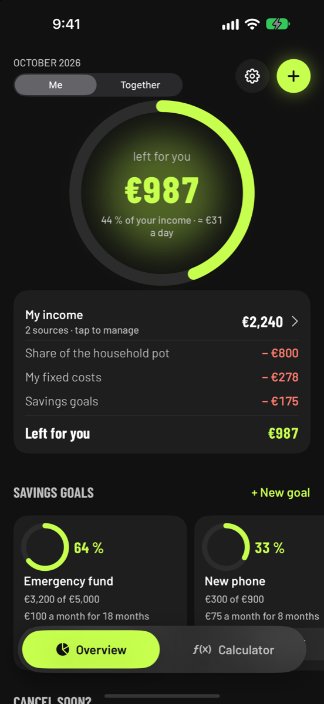
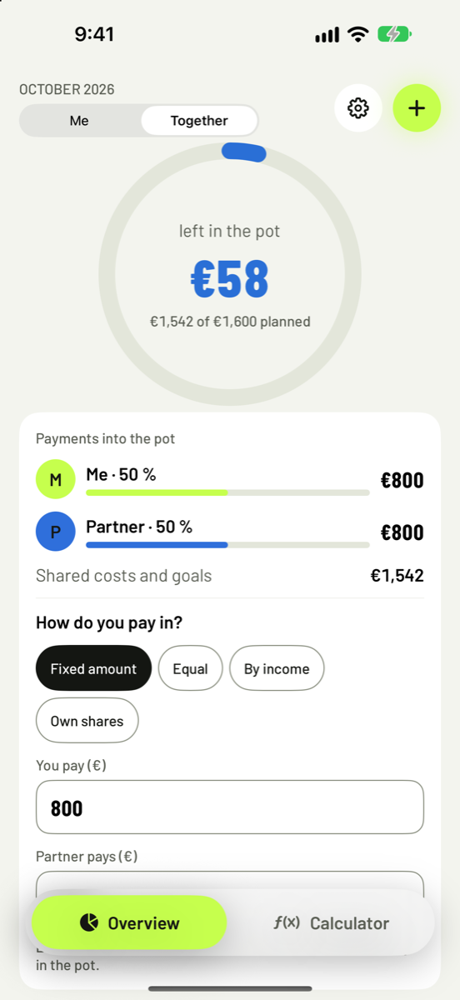
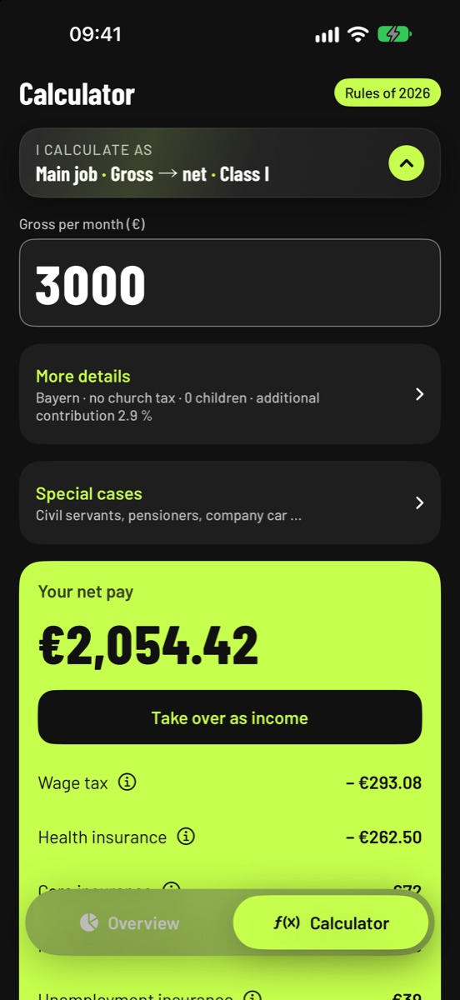
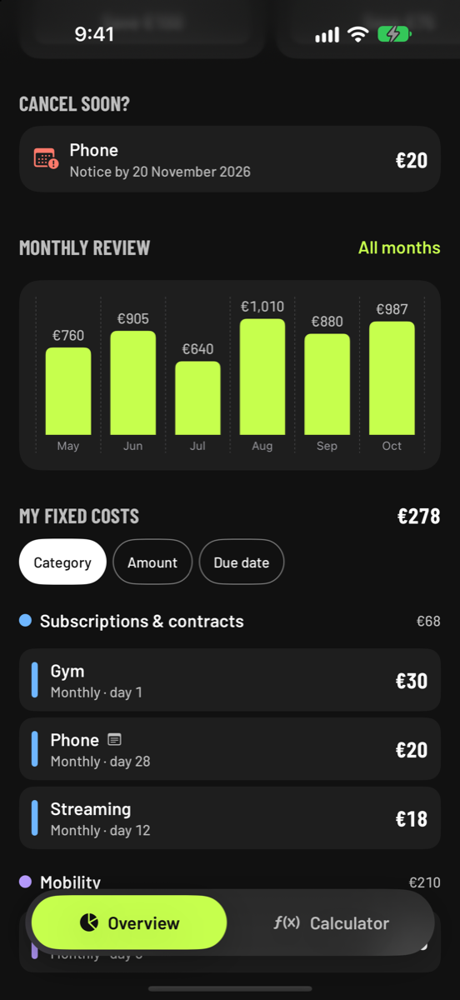

<h1 align="center">Pott</h1>

<p align="center">
  What is left this month? A simple household budget for iPhone.<br>
  No account · no bank login · no ads · no tracking
</p>

<p align="center">
  
  
  
</p>

<p align="center">
  
  
  
  
</p>

## Why Pott?

Pott is a simple household budget for iPhone: income in, fixed costs out, and a ring that shows what remains. Share a household pot with your partner or flatmates, save for goals, and work out German net pay from gross.

No account, no bank login, no ads, no tracking. Your data stays on your devices and in your iCloud.

## Features

- **Overview:** income, fixed costs (monthly, quarterly, yearly) and what is left, by category, amount or due date, with a note on every entry
- **Simple by default:** everything else is a module you switch on in the settings
- **Household:** a shared pot for any number of members, split by fixed amounts, equally, by income or by agreed shares; shared through iCloud while personal entries stay private
- **Savings goals** with the monthly rate worked out for you
- **Pay calculator (Germany):** wage tax, solidarity surcharge and church tax generated from the official BMF pseudocode and checked against the BMF test interface; social insurance including the transition zone, mini jobs and second jobs; desired net
- **Monthly review**, **contract reminders**, home and lock screen **widget**, Face ID lock, CSV export, light and dark, English and German

## FAQ

### Do I have to connect my bank account?

No. Pott has no bank login. You enter income and fixed costs yourself, once, and Pott shows what is left each month.

### Can I share a budget with my partner or flatmates?

Yes. A household pot can have any number of members and is shared through iCloud. Costs can be split by fixed amounts, equally, by income or by agreed shares, and personal entries stay private.

### How accurate is the German gross-to-net calculator?

Wage tax, solidarity surcharge and church tax are generated from the official BMF pseudocode and checked against the BMF test interface. Social insurance includes the transition zone, mini jobs and second jobs. The results are still examples without guarantee.

### Does Pott work outside Germany?

The budget works anywhere. The pay calculator covers Germany only; another country can be added as its own package behind the `NetPayCalculator` protocol (see [Architecture](#architecture)).

### Where is my data stored?

On your devices and in your own iCloud. There is no account with us, no ads and no tracking.

### How can I get it?

Build it yourself with Xcode, see [Build](#build). Start it with `-PottDemo full` to try it with example data.

## Architecture

| Package | Role |
|---|---|
| `PottCore` | Money (exact cents), entries, household split rules, budget calculation, the country-neutral `NetPayCalculator` protocol |
| `PottStore` | Core Data with a private and a shared CloudKit store ([ADR-001](docs/ADR-001-sync.md)) |
| `PottFeatures` | Settings, feature modules and the observable app model |
| `PottDesign` | Colors (WCAG AA tested), fonts, shared components |
| `TaxDE` | German pay calculation; another country plugs in its own package |

The app target only contains views. Every package has tests that run on macOS.

## Build

```sh
xcodegen generate
open Pott.xcodeproj
```

Requires Xcode 27 and iOS 26. To run on a device, pick your own team under Signing & Capabilities. Tests:

```sh
swift test --package-path Packages/PottCore    # and the other packages
```

Start the app with `-PottDemo full` or `-PottDemo simple` to see it with example data.

## Contributing

Contributions are welcome, see [CONTRIBUTING.md](CONTRIBUTING.md). Translations are a good first step.

## License

GPL-3.0, see [LICENSE](LICENSE). © ms-solutions

Pay calculations are examples without guarantee.
